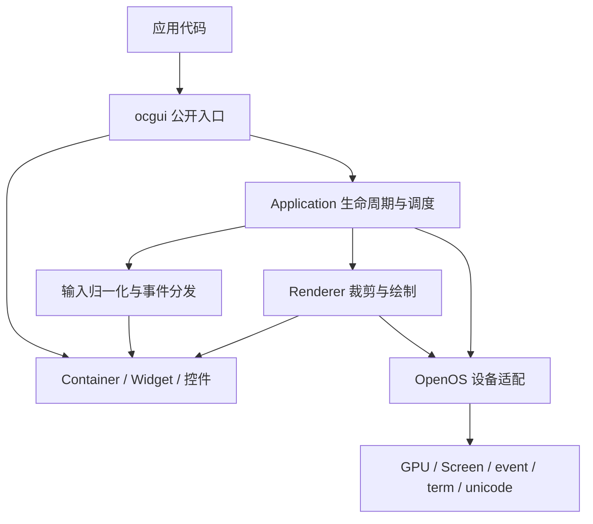

# OpenOS GUI 结构设计

状态：首版最小范围已完成并通过前十批验收。当前保留 0.1.0-dev，未对外发布；硬件兼容范围以实际报告为准。进度见 [PLAN.md](PLAN.md)，验收见 [STAGE10.md](../tests/results/STAGE10.md)。

## 1. 总体结构

采用保留控件树的方式：应用创建并持有控件，修改状态时标记需要重绘，事件到达后命中控件并触发回调。渲染器负责将控件绘制成屏幕字符与颜色。

依赖方向遵守以下边界：

- 公开入口提供构造函数，不保存全局应用实例；加载入口不获取设备、不注册事件、不绘图。可能有初始化副作用的 OpenOS 模块延迟到 `open()` 加载。
- Application 组织生命周期、事件与绘制；控件通过所挂接的根节点申请失效，不反向加载 Application 模块。
- Widget 和 Container 管理状态及树结构，不直接调用 GPU、`event.pull` 或 `term`。
- Renderer 提供绘制上下文并遍历控件树；控件的 `draw(context)` 使用上下文绘图，不能越过上下文调用设备。
- OpenOS 适配器是唯一接触设备代理和终端状态的层。单元测试可以替换此层。
- 使用普通 Lua table 与少量 metatable 共享方法，不引入类框架、全局事件总线或额外包管理依赖。

## 2. 规划源文件

所有路径相对 `OpenOS-GUI/lib/`。这些 Lua 文件按实施阶段创建，当前不生成占位实现。

| 文件 | 职责 | 主要依赖 |
| --- | --- | --- |
| `ocgui.lua` | 公开构造函数与版本标识 | application、container、具体控件 |
| `ocgui/application.lua` | 生命周期、单步循环、重绘调度、错误清理 | dispatcher、renderer、platform/openos、theme |
| `ocgui/widget.lua` | 基础状态、坐标、失效、局部处理器 | geometry |
| `ocgui/container.lua` | 子节点、父子关系、绘制顺序 | widget |
| `ocgui/geometry.lua` | 矩形相交、包含、坐标转换 | 无设备依赖 |
| `ocgui/input.lua` | 原始信号转为 GUI 事件，筛选输入设备 | 无设备依赖 |
| `ocgui/dispatcher.lua` | 路径快照与事件冒泡 | 控件树 |
| `ocgui/interaction.lua` | 焦点、指针捕获、期限与路由 | input、dispatcher、控件树 |
| `ocgui/painter.lua` | 整帧树绘制与修改保护 | renderer、theme、控件树 |
| `ocgui/renderer.lua` | 绘制上下文、裁剪栈、颜色缓存 | geometry、text、设备适配接口 |
| `ocgui/text.lua` | 显示宽度、按单元格截断与对齐 | 注入的 unicode 接口 |
| `ocgui/theme.lua` | 默认主题及控件样式解析 | 无设备依赖 |
| `ocgui/platform/openos.lua` | 获取设备、拉取事件、时间、状态保存恢复 | OpenOS 原生模块 |
| `ocgui/label.lua` | 单行文本标签 | widget |
| `ocgui/button.lua` | 按下状态与激活逻辑 | widget |

## 3. 控件树与坐标

每个应用持有一个根 Container。每个控件只属于一个父节点；跨应用或跨父节点添加前必须先移除，禁止环和重复添加。移除只是脱离树，可重新添加；关闭应用会解绑整棵树及其应用引用。

控件基础状态包括边界、可见性、启用状态、是否可聚焦、父节点和样式。首版通过 setter 修改状态；直接写内部字段不属于公开契约。

- 坐标以字符单元格为单位，从 1 开始。`x/y` 相对父容器左上角；全局坐标为 `parentX + x - 1`、`parentY + y - 1`。
- `x/y` 是整数，允许控件部分位于父容器外；`width/height` 是正整数。矩形内部使用半开区间 `[x, x + width)`，避免边界重复命中。
- 子控件按添加顺序绘制，后添加的位于上层；命中按相反顺序遍历。绘制和命中均受所有祖先裁剪区域限制。
- 首版使用绝对定位。后续布局器统一调用 `setBounds()`，不修改渲染器和事件坐标规则。
- 隐藏控件及其子树不参与绘制、命中与焦点遍历。可见但禁用的控件仍绘制，并阻挡其覆盖范围内的指针事件，避免点击穿透。
- Label 默认不接收指针事件，Button 接收指针并可聚焦；普通 Container 仅在没有子节点命中时作为候选。
- 修改位置、尺寸、文本、样式、可见性、启用状态或树结构都触发失效；移除和移动同时覆盖旧位置与新位置。

事件回调可以修改树。分发开始时保存目标到根的路径；后续执行前检查节点仍挂接且可用。新节点不接收正在分发的事件；结构变更在下一次绘制中体现。

## 4. 生命周期与设备归属

生命周期为 `created -> open -> closed`；关闭后不可重新打开，需要创建新实例。

| 操作 | 约定 |
| --- | --- |
| 构造 | 只创建 Lua 对象，可以在没有 GPU 的环境完成 |
| `open()` | 查设备、保存状态、创建根节点设备上下文、申请首次重绘；不拉取事件 |
| `step(timeout)` | 最多拉取一条信号、分发事件、处理本地期限、必要时绘制一次 |
| `dispatch(...)` | 仅分发宿主已取得的原始信号，不再次拉取事件、不立即绘制 |
| `nextTimeout(maxWait)` | 返回下一本地期限与调用者等待上限的较小值，无两者时返回 nil |
| `render()` | 有失效时绘制一帧；没有失效则不调用 GPU |
| `stop()` | 标记停止、取消交互状态，不在回调栈中递归关闭 |
| `close()` | 解绑交互和树，清理本实例资源并恢复设备状态；重复调用安全 |
| `run()` | 只接受 created 状态，负责 open、循环和最终 close |

step 先检查停止与过期交互；若已有待绘制修改，立即绘制并返回，不先阻塞等待输入。否则按 nextTimeout 拉取至多一个信号，分发后按需绘制再返回。每次 step 最多绘制一帧，首次调用也能直接显示界面。

独立模式使用 `run()`。宿主驱动模式显式使用 `open/nextTimeout/dispatch/render/close`，事件队列只有宿主一个消费者；等待超时后以无参数 dispatch 推进本地期限。两种模式不能同时使用；回调内禁止再次 `run/step/dispatch/render/close`，允许修改控件及调用 `stop()`。

设备策略：

- 首版一个应用对应一个 GPU 和已绑定屏幕；同一 GPU 同时只允许一个活动应用。适配器维护本库内的占用记录，不修改全局环境。
- 默认使用当前终端的 `term.gpu()`；也允许显式传入 GPU 代理。没有 GPU 或没有已绑定屏幕时返回错误，不自动绑定别的屏幕。
- 首版面向直接连接屏幕的全屏 OpenOS 终端。应用独占屏幕绘制期间，调用者不并行输出终端文本；嵌套终端窗口、远程 TTY、多屏及跨进程设备仲裁留待后续。
- 不更改分辨率、色深、调色板或屏幕绑定。根区域取当前屏幕可见 viewport；屏幕变化时重新读取尺寸并全量失效。
- 支持活动缓冲接口时，保存原缓冲索引，再选择屏幕缓冲 0，随后读取并保存屏幕颜色；退出时先恢复屏幕颜色，再恢复原活动缓冲。接口不具备时沿用普通屏幕调用，不强制依赖 VRAM。
- 保存颜色时同时保存调色板标志，RGB 绘制显式传入 `false`。仅当使用当前终端 GPU 时管理其光标位置和闪烁；显式使用其他 GPU 时不触碰当前终端光标。
- 默认退出时以保存的颜色清理应用区域，再恢复颜色、活动缓冲和所管理的光标。不会恢复运行前的屏幕文字；不为此保留整屏截图。
- GPU 解绑、移除或失去可调用状态时停止。清理按步骤尽力完成，释放本库占用记录；不因一个恢复操作失败而跳过其余恢复。

`run()` 用受保护的调用包围启动和循环。回调或 GPU 出错时先清理再返回错误；宿主驱动模式出错后标记停止，由宿主保证最终 `close()`。启动只完成部分步骤时也必须回滚已修改的状态。系统强制终止或硬件消失时无法保证恢复成功，错误中记录未完成的清理项。

设备适配器内部接口分为：`open/close` 管理状态快照；`getSize/getKeyboards` 读取可见区域与输入来源；`setForeground/setBackground/fill/set` 执行渲染；`pull(timeout)` 原样返回信号；`now()` 提供单调运行时间。GPU 代理调用细节封装在这里，控件和渲染器不依赖代理的调用约定。测试假设备提供相同接口，并能注入启动或恢复失败。

## 5. 输入与事件分发

输入归一化使用 `type/source/player/x/y/button/delta/char/code` 等字段，并保留原始信号 table。字段按事件类型存在；缺失的玩家名保持 nil，不要求服务器启用玩家名输入。

| OpenOS 信号 | GUI 事件 | 目标 |
| --- | --- | --- |
| `touch` | `pointer_down` | 命中控件 |
| `drag` | `pointer_drag` | 捕获者或命中控件 |
| `drop` | `pointer_up` | 捕获者或命中控件 |
| `scroll` | `scroll` | 命中控件 |
| `key_down` / `key_up` | 同名事件 | 当前焦点控件 |
| `clipboard` | `text_paste` | 当前焦点控件，首版只保留路由能力 |
| `screen_resized` | 应用内部尺寸更新 | 根容器 |
| `interrupted` | 请求停止 | 应用 |

只接受绑定屏幕的指针和尺寸信号；键盘信号只接受该屏幕 `getKeyboards()` 返回的地址。初次打开、相关组件变化时刷新集合；不在每次绘制时查询。输入坐标先取整，再转换成目标控件局部坐标。输入隔离是设备筛选，不是玩家权限系统。

事件从目标向根冒泡，处理器返回 `true` 表示已消费并终止。`target` 不变；每次调用更新 `currentTarget` 和局部坐标。框架默认行为先处理，再调用用户处理器；禁止重入分发。首版不提供捕获阶段、可取消默认行为或全局总线。

按钮状态机：左键 `pointer_down` 时获得焦点并捕获指针；匹配来源、玩家和按钮的 `pointer_up` 在按钮内部释放时触发一次 `click`。在外部释放只取消按下状态。拖出后拖回再释放可激活。第二个不匹配的指针不能释放已有捕获。首版不依赖悬停事件。

只有一个焦点和一个指针捕获。Tab 按控件树顺序移动焦点，Shift+Tab 反向；Enter/Space 按下并释放可激活聚焦按钮，重复 key_down 不重复激活。修饰键及按下状态按键盘来源记录，避免不同设备混用。

捕获的控件被移除、隐藏、禁用，或屏幕变化、应用停止时，立即取消交互。为丢失的释放信号设置本地 5 秒交互期限，超时仅取消，不触发 click；`step()` 的等待时间不能超过该期限。暂不保证多玩家同时交互，所有玩家共享当前焦点。

独立循环使用不带信号名称过滤的 `event.pull(timeout)`，未知信号返回未处理；不重新入队。业务程序需要共同处理其他组件信号时采用宿主驱动模式。首版不调用 `event.listen/event.timer` 注册长期后台回调，本地期限由应用循环管理。

## 6. 渲染与性能

首版选择直接绘制与合并失效：同一批状态修改仅设置一个 dirty 标志，一次事件处理后最多绘制一帧。该帧先填充根背景，再按顺序绘制可见控件。这样移动、删除、遮挡变化不会留下旧像素。

Renderer 提供 `fillRect`、`drawText` 和裁剪栈；所有坐标经过边界检查，空相交直接跳过。上下文只在当前 draw 调用有效，不能保存到下一帧。绘制期间禁止修改控件树或触发用户回调。

文本不使用字节长度进行对齐；通过 unicode 接口按字符遍历并累计显示宽度。宽字符被左右裁剪切断时，对应可见单元格留作背景，不绘制半个字符。单行文本中的换行、制表等控制字符使用空格替换。首版不承诺字素簇、组合字符或 emoji 排版能力，游戏字体行为需实测。

在一帧内缓存最后设置的前景和背景，连续同色绘制省去重复设色；不跨帧假定 GPU 状态。空闲且无期限时允许阻塞等待，避免忙轮询。首版不设置固定帧率、不做动画、不申请 GPU 离屏缓冲，也不创建每单元格 Lua table 的整屏双缓冲。

完成正确性验证后再按测量结果优化：脏矩形、行片段合并、GPU 缓冲属于内部策略，保持控件 draw 和公开 API 不变。没有实测前不承诺帧率、显存或调用预算数值。

## 7. 扩展与实施边界

主题采用“内置默认值 -> 应用主题 -> 控件样式”逐字段覆盖；定义普通、按下、禁用、焦点状态。应用主题在构造时复制，更新走 setter 并触发重绘，不共享可变全局主题。

首版实现公开入口、Application、Widget、Container、Renderer、设备适配、Label 和 Button，以及支撑它们的输入、几何和文本模块。测试先覆盖纯逻辑与假设备，再做 OpenOS 游戏内验证。

后续沿现有边界增加：Input 负责文本编辑；布局器计算 setBounds；滚动容器增加内容坐标偏移；Window 仍作为 Container 子类。桌面、应用管理器、多屏、动画、完整图片格式和对 MineOS API 的兼容层均不纳入首版。

验证矩阵与源码查证入口分别见 [测试约定](../tests/README.md) 和 [实施清单](PLAN.md)。
